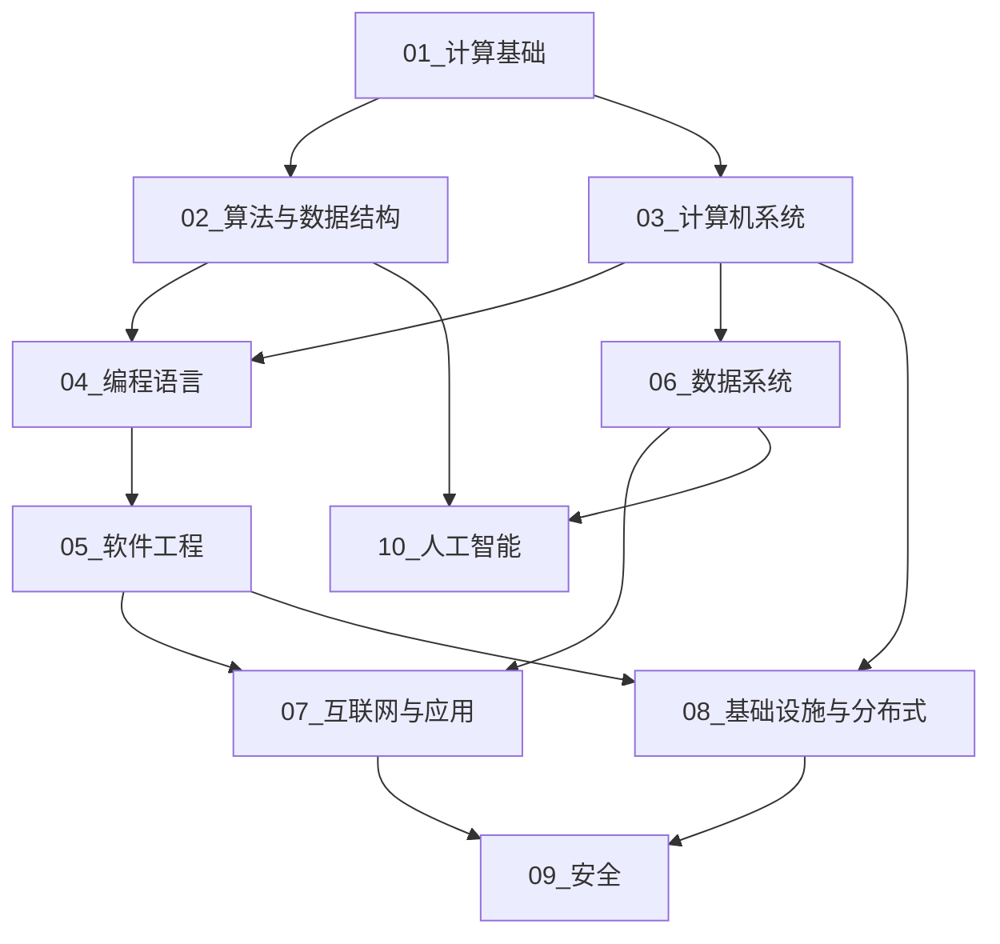

# 全景：域与域之间的依赖

一张总图。箭头表示「大致先修 → 后续」；同层可以平行学。安全（09）与人工智能（10）横跨多域，仍各自独立成域，以免变成标签桶。

## 阅读提示

| 关系 | 说明 |
|------|------|
| 01 → 02、03 | 信息表示与离散基础托住算法与系统 |
| 02、03 → 04 | 算法思维与机器模型托住语言实现观 |
| 04 → 05 | 语言能力之上谈可维护软件 |
| 03 → 06、08 | 系统与网络是数据与分布式的底座 |
| 05、06 → 07 | 工程与数据托住互联网应用 |
| 07、08 → 09 | 应用与基础设施是安全的主战场 |
| 02、06 → 10 | 算法与数据托住人工智能 |

细节边界与「不包含什么」见各域 `README.md`；交叉引用规则见 [../分类.md](../分类.md)。
